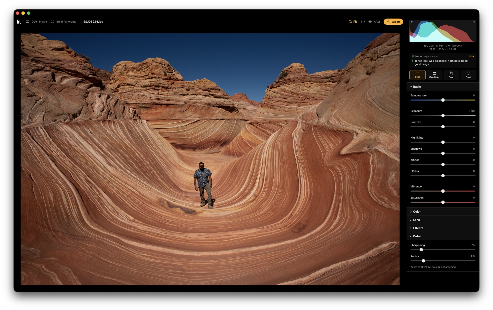
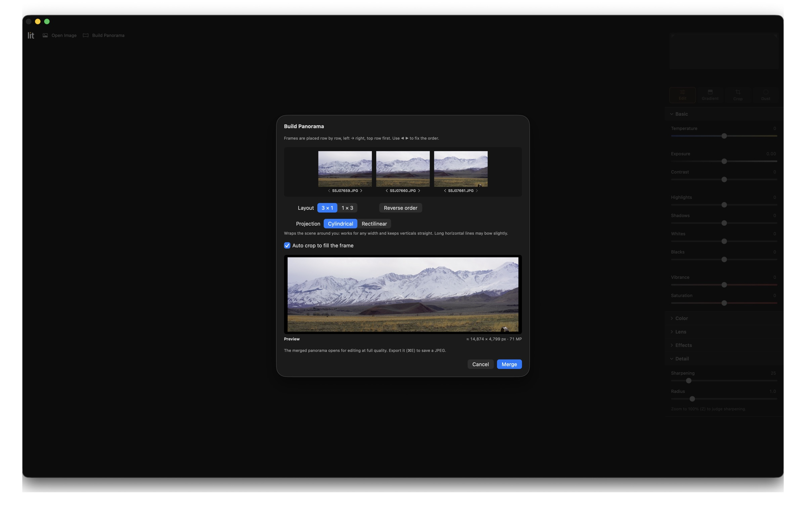

<p align="center">
  <picture>
    <source media="(prefers-color-scheme: dark)" srcset="Assets/Wordmark.png">
    
  </picture>
</p>

<p align="center"><b>Simple, honest photo editing for macOS.</b></p>

lit is a tiny, fast photo editor for landscape photographers. Open a RAW or JPEG, make a few
tweaks, export. Under 1 MB, nothing to import, nothing to set up.

## What it can do

- **Basic sliders** for light and colour: exposure, contrast, highlights, shadows, white balance and more
- **Graduated filters** you drag across the sky, angle and stack
- **Panoramas** stitched from 2–9 photos, with a live preview
- **Crop and straighten**, your camera's **lens corrections**, and a **dust speck** remover
- **JPEG export** with your camera info kept

## Install

### [⬇ Download lit](https://github.com/sandeep-josyula/lit/releases/latest/download/LIT.zip)

Needs a Mac with Apple silicon (M1 or newer) and macOS 14 Sonoma or later.

1. **Unzip** `LIT.zip` and drag **LIT** into **Applications**.
2. **Open LIT.** The first time, macOS blocks it because lit isn't registered with Apple yet.
   Go to **System Settings → Privacy & Security**, click **Open Anyway** next to *"LIT" was
   blocked*, enter your password and click **Open**. You only do this once.

To remove lit, drag it to the Trash. Your photos are never touched.

<p align="center">
  
  <br>
  <sub>That's me, at The Wave in Arizona, 2024.</sub>
</p>

<p align="center">
  
  <br>
  <sub>Building a panorama: set the order, layout and projection, and see the result before you merge.</sub>
</p>

## What it won't do

No content-aware fill, no sky replacement, no AI generation, no reshaping. lit improves what
your camera captured; it never changes what was there.

## Privacy

lit collects **zero** data. No analytics, no statistics, no crash reports, no accounts. It has
no networking code at all, so it never connects to the internet. Your photos stay on your Mac.

## Handy keys

| | |
|---|---|
| **E** · **G** · **C** · **D** | Edit · Gradient · Crop · Dust |
| **Z** or pinch | Zoom to 100% and back |
| **\\** | Before / after |
| **B** | Black or white background |
| **J** | Show clipped highlights and shadows |
| **⌘E** · **⇧⌘P** | Export · Build a panorama |

## Free and open source

lit is free under the [MIT License](LICENSE). Use it, change it, share it, build on it.

Need a feature? [Open a feature request](https://github.com/sandeep-josyula/lit/issues/new)
and tell us how you'd use it.

<details>
<summary>For developers</summary>

lit is written in Swift with Apple's Core Image and has no other dependencies. RAW files are
decoded by Apple's RAW engine, then everything runs on the GPU in linear light. Sony lens
corrections come from the data the camera stores in each ARW. Panoramas are projected
(cylindrical or rectilinear), aligned with FFT phase correlation plus rotation refinement,
exposure-matched and blended. Code: `Sources/LitCore` (engine), `Sources/Lit` (app),
`Sources/lit-cli` (test tool).

Thanks to the [darktable](https://www.darktable.org) project, whose open documentation and
code showed how Sony stores lens corrections in ARW files. lit's implementation is its own.

```sh
scripts/build-app.sh --install    # build and install locally
```

Releases use [semantic versioning](https://semver.org). Push a tag and GitHub Actions builds
LIT.app, zips it and publishes the release that the download link points to:

```sh
git tag v1.1.0 && git push origin v1.1.0
```

Pull requests are built automatically too.

</details>
